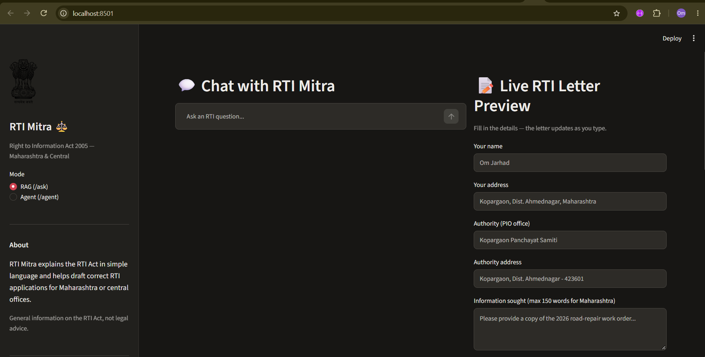
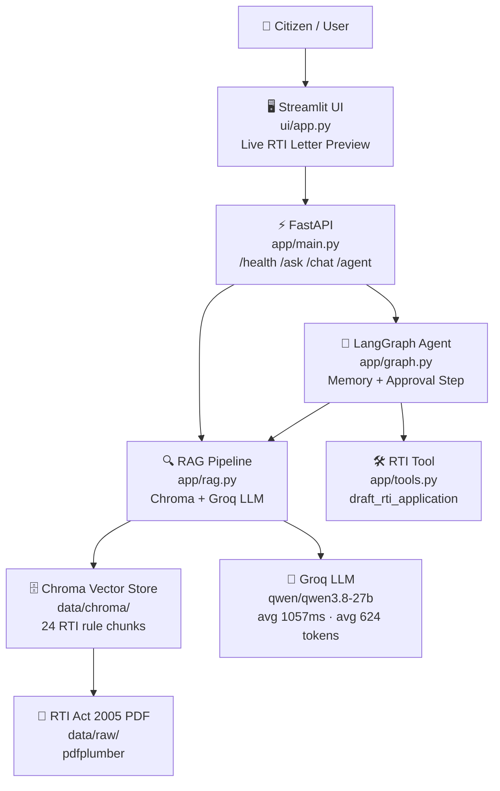

# RTI Mitra

[](https://github.com/Omi7590/Agentic-AI-training/actions/workflows/ci.yml)

**RTI Mitra** explains the Right to Information (RTI) Act in simple language and helps draft a correct RTI application for a Maharashtra or central public office, with the right fee, the 150-word limit and the reply deadline.

---

## Project card

- **Product**: RTI Mitra — explains the RTI Act in simple language and drafts a correct RTI application for a Maharashtra or central office, with fee, word limit and reply deadline.
- **User**: A final-year student in Kopargaon who has never filed an RTI and wants to know, through RTI, why the gram panchayat's road-repair work order is pending.
- **Problem**: The RTI process is confusing — different rules apply to central vs Maharashtra authorities, the legal language is hard, and most citizens do not know the fee, the deadlines or how to draft a valid application.
- **Data source**: RTI Act and DoPT guide at https://rti.gov.in/ and https://rti.gov.in/Writereaddata/RTI-Act.pdf

> General information on the RTI Act, not legal advice.

---

## Progress

| Day | Topic | Status |
|-----|-------|--------|
| Day 1 | Python basics, variables, loops, GitHub | ✅ Done |
| Day 2 | Collections, functions, modules | ✅ Done |
| Day 3 | Files, errors, dataclass, requests | ✅ Done |
| Day 4 | FastAPI, pandas, TF-IDF smart search | ✅ Done |
| Day 5 | How LLMs work, 10 user questions | ✅ Done |
| Day 6 | Groq LLM wrapper, /chat, prompts | ✅ Done |
| Day 7 | Chunking, embeddings, Chroma, /search/semantic | ✅ Done |
| Day 8 | RAG /ask endpoint, eval set, 2 config runs | ✅ Done |
| Day 9 | Agent tool, hand-written agent, LangGraph /agent | ✅ Done |
| Day 10 | Streamlit chat UI with live RTI letter preview | ✅ Done |
| Day 11 | Tests (25 pytest), ruff clean, Docker | ✅ Done |
| Day 12 | GitHub Actions CI, deploy on Render | ✅ Done |
| Day 13 | Production logging, cache, input limits, prompt injection test | ✅ Done |

---

## Project structure

```
Agentic-AI-training/
├── analysis/
│   └── explore.py          # 3 pandas facts about RTI records
├── app/
│   ├── __init__.py
│   ├── cli.py              # interactive CLI record explorer
│   ├── fetch.py            # downloads RTI source documents
│   ├── ingest.py           # cleans records and saves records.json
│   ├── main.py             # FastAPI service
│   ├── models.py           # Record dataclass
│   ├── records.py          # load, search, count, get_by_id
│   └── smart_search.py     # TF-IDF cosine similarity search
├── data/
│   ├── raw/                # downloaded source files (git-ignored)
│   ├── sample_records.py   # 20 RTI rule records
│   └── records.json        # cleaned records (generated by ingest.py)
├── docs/
│   └── how_llms_work.md    # how LLMs work in plain language + diagram
├── eval/
│   └── questions.md        # 10 real RTI Mitra user questions
├── day01_intro.py          # project card + input()
├── day01_menu.py           # while-loop menu
├── requirements.txt
└── .gitignore
```

---

## How to run

### Install dependencies

```powershell
pip install -r requirements.txt
```

### Day 1 — intro and menu

```powershell
python day01_intro.py
python day01_menu.py
```

### Day 2 — record explorer CLI

```powershell
python -m app.cli
```

### Day 3 — fetch source documents and ingest records

```powershell
python app/fetch.py
python app/ingest.py
```

### Day 4 — start the API

```powershell
uvicorn app.main:app --reload
```

Open http://127.0.0.1:8000/docs for the interactive Swagger UI.

### Day 4 — data explorer

```powershell
python analysis/explore.py
```

### Day 10 — Streamlit UI

Start the API first, then in a second terminal run:

```powershell
streamlit run ui/app.py
```

Opens at http://localhost:8501

---

## Streamlit UI — screenshot



The UI has two panels:
- **Left**: chat with RTI Mitra using `/ask` (RAG) or `/agent` (LangGraph). Every answer shows citations and thumbs up/down feedback buttons.
- **Right**: live RTI letter preview — as you type the information sought, it fills the Annexure 'A' format, shows a 150-word counter, a fee box (Rs 10 or nil for BPL) and a reply due date computed with `datetime`.

---

## API endpoints

| Method | Path | Description |
|--------|------|-------------|
| GET | /health | Health check |
| GET | /records?limit= | List records (default 10, max 100) |
| GET | /records/{id} | Get one record by ID (404 if missing) |
| GET | /search?q= | TF-IDF semantic search |
| GET | /search/semantic?q= | Semantic search via Chroma |
| POST | /questions | Ask a plain-language RTI question |
| POST | /chat | LLM answer with confidence and follow_up |
| POST | /ask | RAG answer with citations |
| POST | /agent | LangGraph agent with memory and approval step |

---

## Live deployment

- **API**: https://rti-mitra-mq86.onrender.com
- **Health check**: https://rti-mitra-mq86.onrender.com/health
- **API docs**: https://rti-mitra-mq86.onrender.com/docs
- **UI**: https://rti-mitra-ui.onrender.com

---

## Run with Docker

Make sure Docker is installed and running, then:

```bash
docker compose up --build
```

This starts two containers:
- **API** at http://localhost:8000 — FastAPI service (`/health`, `/ask`, `/agent`, etc.)
- **UI** at http://localhost:8501 — Streamlit chat with live RTI letter preview

To stop:
```bash
docker compose down
```

The `.env` file must exist with your `GROQ_API_KEY` before running.

---

## Architecture



---

## Production notes

Measured on 5 real RTI questions via Groq API (qwen/qwen3.8-27b):

| Metric | Value |
|--------|-------|
| Average latency | 1,057 ms |
| Min latency | 681 ms |
| Max latency | 1,331 ms |
| Average tokens per request | 624 |
| Average prompt tokens | 372 |
| Average completion tokens | 252 |
| Cache TTL | 300 seconds |
| Input limit | 500 characters |
| Prompt injection defence | ✅ tested |

**Cache**: in-memory TTL cache (5 min) on `/ask` — repeated questions return instantly with `cached: true`.

**Input limits**: questions over 500 characters are rejected with HTTP 422 before hitting the LLM.

**Prompt injection**: grounded RAG returns answers only from indexed RTI rule chunks. Injected instructions ("ignore previous", "jailbreak") are detected and refused — tested in `tests/test_all_days.py`.

---

## Results

| Component | Result |
|-----------|--------|
| RTI rule records | 24 (4 from PDF + 20 curated) |
| Chroma chunks | 24 |
| Eval score (Config B, top-k=5) | 15/15 questions |
| Prompt comparison | V2 beats V1 on all 10 questions |
| Tests | 28 passing, 0 failing |
| Ruff lint | ✅ All checks passed |
| CI badge | ✅ Green |
| Live API | https://rti-mitra-mq86.onrender.com |
| Live UI | https://rti-mitra-ui.onrender.com |

---

## RAG Evaluation — Config winner

| Config | top_k | Score |
|--------|-------|-------|
| Config A | 3 | 14/15 |
| Config B | 5 | 15/15 |

**Winner: Config B (top_k=5)** — fetching 5 chunks gives the LLM enough context for multi-part questions like appeal deadlines and APIO rules.

---

## Key RTI rules covered

- Application fee: Rs 10 (central and Maharashtra), nil for BPL
- PIO reply deadline: 30 days (35 days via APIO, 48 hours for life and liberty)
- Transfer under Section 6(3): 5 days
- First appeal: within 30 days, Rs 20 fee in Maharashtra
- Second appeal: within 90 days to CIC or SIC
- Exemptions: Section 8 (national security, personal privacy, etc.)
- Word limit: 150 words in Maharashtra
- Online portals: rtionline.gov.in (central), aaplesarkar.mahaonline.gov.in (Maharashtra)
